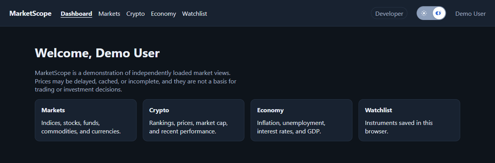
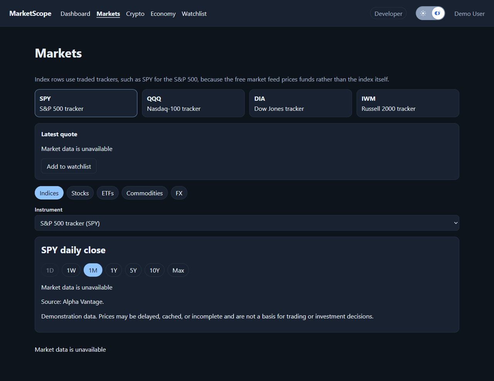
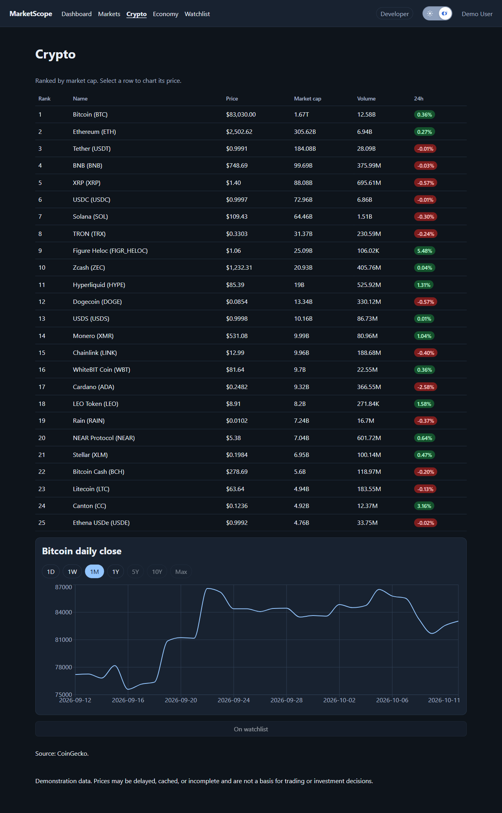
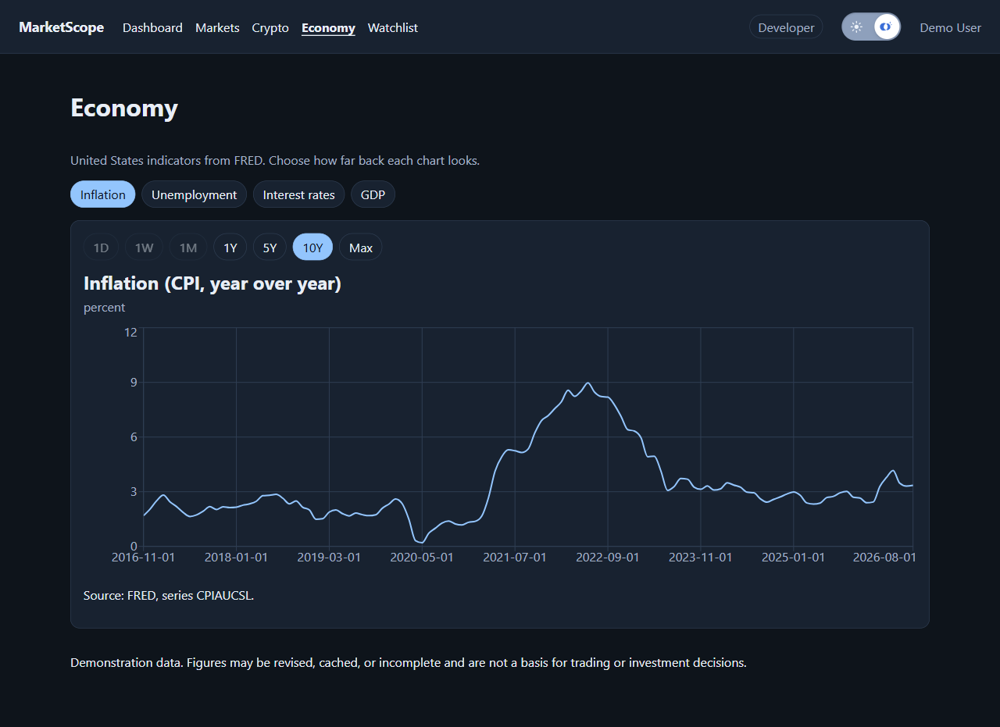
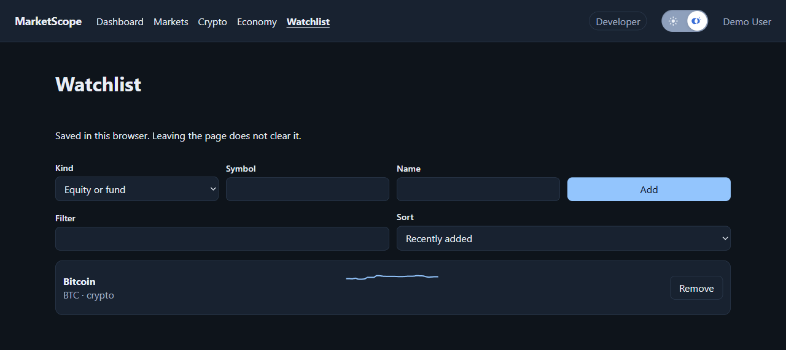

# MarketScope

MarketScope is a market dashboard you can click around in. It is a demo, not a place to trade. Prices can be late, cached, or missing. Do not use them to decide what to buy or sell.

The site you open is a shell. It loads four other pages:

- **Markets** shows indices, stocks, funds, commodities, and currencies. The numbers come from [Alpha Vantage](https://www.alphavantage.co/). Index rows use traded funds, such as SPY for the S&P 500, because that feed prices funds rather than the index itself.
- **Crypto** lists coins by market cap and charts a price. The numbers come from [CoinGecko](https://www.coingecko.com/).
- **Economy** charts US inflation, unemployment, the federal funds rate, and GDP. The numbers come from [FRED](https://fred.stlouisfed.org/).
- **Watchlist** keeps instruments you add. The list stays in this browser.

There is no login. The header shows a demo user. The switch next to Developer turns dark mode on and off.

## Screens

The pictures below are in dark mode.

### Dashboard



### Markets



A free Alpha Vantage key allows 25 requests a day. After that, the quote and the chart say the data is unavailable. That is what this picture shows.

### Crypto



### Economy



### Watchlist



## Clone and run

You need [Node.js](https://nodejs.org/) and npm.

```bash
git clone https://github.com/kevinsmithwebdev/marketscope.git
cd marketscope
```

Install the shell, each page, the shared UI package, and the API:

```bash
npm install
npm install --prefix apps/shell
npm install --prefix apps/markets
npm install --prefix apps/crypto
npm install --prefix apps/economy
npm install --prefix apps/watchlist
npm install --prefix packages/ui
npm install --prefix services/api
```

### API keys

Copy `services/api/.env.example` to `services/api/.env`.

Markets needs an Alpha Vantage key. Get a free one at <https://www.alphavantage.co/support/#api-key> and put it in `ALPHA_VANTAGE_API_KEY`. The free key allows 25 requests a day.

Economy charts need a FRED key. Get a free one at <https://fred.stlouisfed.org/docs/api/api_key.html> and put it in `FRED_API_KEY`.

The crypto page does not need a key.

### Start

```bash
npm start --prefix services/api
```

That starts the API on port 4000 and the web pages. Open <http://localhost:3000>.

The shell is on port 3000. Markets, crypto, economy, and watchlist run on ports 3001 to 3004. If one of those fails to load, the shell stays up and that page shows an error.

The Developer button can stop one page, or make the next API call fail or time out, so you can see those error states.
